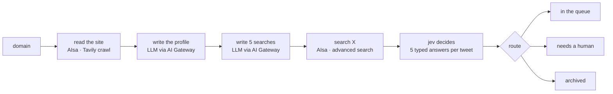

# Worth Replying

**Give it a domain.** It reads your site, works out who you are for, then reads X and comes back with the conversations worth answering.

No keywords, no forms, nothing to set up. Every call on every tweet is made by [jev](https://typesafe.ai/blog/introducing-system-one-models-and-jev) — TypeSafe's System One model — which answers five typed questions in one request, each with a calibrated probability, in a few hundred milliseconds. Values, never sentences.

**[Live demo → worth-replying.aisa.one](https://worth-replying.aisa.one)**

> **Built on [AIsa](https://aisa.one)** — sign in with your AIsa account. Website reads and X searches are charged to **your personal AIsa balance**. Worth Replying pays for profile/query generation and jev through Vercel AI Gateway. No database is required.

## How it works



1. **Domain** — type one in.
2. **Profile** — the site is crawled a few pages deep, and a language model writes down what you do, who buys it, what hurts them, and who else they would consider. From that profile it writes five X searches, then runs one page of each to measure how much each one actually returns. You watch all of this happen: pages land, the profile types itself out, the searches follow.
3. **Run** — every search is paged through in parallel. Each new tweet goes to jev, eight at a time, and the console fills in live: the tweet being decided, the five answers against their thresholds, where it was routed, and what it has cost so far.

4. **Review** — everything jev did not archive, best opening first, with its five answers. Each one has a **Reply on X** button that opens X's composer already addressed to that tweet, and a link to the tweet itself. You can step here while the run is still going: the run carries on and the list keeps growing. You write the reply; you send it.

Step 5 of the design (**Sent**) is not built, and drafting replies is deliberately left out. Nothing is ever posted.

### The five questions

jev is asked these about every tweet, in a single request:

| Answer | Type | What it is for |
| --- | --- | --- |
| **Is ICP** | boolean | Is the author a plausible buyer? Shown, not required. |
| **Pain** | choice | Which of the profile's pains the tweet expresses, or `none`. |
| **Reply value** | score 0–3 | Is a reply worthwhile — to help the author, *or* to be seen in a conversation your audience is reading? This alone decides whether a tweet is worth answering. |
| **Needs human** | boolean | Large account, heated thread, anything where a clumsy reply costs reputation. Sends the tweet to a person instead of the queue. |
| **Injection** | boolean | Does the tweet contain instructions aimed at an AI reading it? Such tweets are never queued. |

The thresholds live in [`lib/decision.ts`](lib/decision.ts) and are shared by the server, which routes on them, and the console, which draws them as the tick on each track. The rubric and the wording of each question are in [`lib/server/jev.ts`](lib/server/jev.ts).

## About AIsa

[**AIsa**](https://aisa.one) is the unified resource and transaction network for AI agents: one account and one key for discovering, calling, and paying for models, APIs, real-time data, and tools — 950+ APIs behind a single surface, billed per call.

This project is a small, complete example of what that buys you. It needs two very different kinds of data — a crawl of an arbitrary website, and a live search of X — which would normally mean two providers, two keys, two billing relationships and two sets of quirks. Here it is one client in [`lib/server/aisa.ts`](lib/server/aisa.ts), about two hundred lines:

| What the app needs | AIsa endpoint | |
| --- | --- | --- |
| Read a company's site | `POST /tavily/crawl`, `/tavily/extract` | pages as clean markdown |
| Find the conversations | `GET /twitter/tweet/advanced_search` | tweets with authors, newest first |
| Know what it cost | every response | the real charge, in the `x-aisa-customer-cost-micros-usd` header |

The cost header records actual AIsa data charges. On-screen dollar totals show only website-funded model calls; personal AIsa data charges are additional.

The AIsa platform offers more than this demo uses:

- **Models** — an OpenAI-compatible gateway to the major model families.
- **Data APIs** — web and news search, X/Twitter, Reddit, YouTube, company and people data, financial and market data, academic search, prediction markets.
- **MCP** — one endpoint, `https://mcp.aisa.one/mcp`, puts the whole catalogue in front of an agent, with the price of each call available before it is made. The `gtm` module is the go-to-market set: people and company search, creator discovery, and social listening — the natural next step for a tool like this one.
- **Machine payments** — agents can discover and pay for capabilities programmatically, including pay-per-call over x402.

Start here: [aisa.one](https://aisa.one) · [Docs](https://aisa.one/docs) · [API reference](https://aisa.one/docs/api-reference) · [MCP catalogue](https://mcp.aisa.one/servers)

## Quick start

Requires **Node 22+** and **pnpm**.

```bash
git clone https://github.com/AIsa-team/worth-replying.git
cd worth-replying
pnpm install
cp .env.example .env.local   # configure OAuth, cookie encryption, and the model gateway
pnpm dev
```

Complete the one-time OAuth client setup below, then open <http://localhost:3000>. The homepage is public. Enter a domain and click Find to open the AIsa sign-in prompt; successful sign-in resumes that domain. Account controls sit at the right of the existing header. For a cheap first run, add `?target=40` to the run page URL — it reads 40 tweets instead of 1,000.

## OAuth and deployment setup

Register **one stable Worth Replying web OAuth client** with AIsa/Clerk through your approved operator process. This app never registers clients during login and has no database or new tables. Use the authorization-code grant, response type `code`, and PKCE `S256`. Register exact callback URIs for each environment, for example:

- `http://localhost:3000/auth/callback`
- `https://worth-replying.aisa.one/auth/callback`

Use `token_endpoint_auth_method=none` for a public PKCE client, or `client_secret_basic` for a confidential server client. Set the secret only for the latter. Allowed/requested scopes are `openid profile email`. Do **not** add `user:org:read` (organization selection) or `offline_access`: this app uses personal billing and does not retain refresh tokens.

The fixed trusted endpoints are `https://clerk.aisa.one/oauth/authorize` and `/oauth/token`; client registration is available at `/oauth/register` for operators. Data calls use `https://api.aisa.one/apis/v1` with the caller's access token. There is **no deployment-key fallback**.

| Variable | Required | Purpose |
| --- | --- | --- |
| `APP_ORIGIN` | yes in deployment | Canonical origin, e.g. `https://worth-replying.aisa.one`; no path. Used for callback/return destinations and Origin validation; request Host headers are never trusted. HTTP is allowed only for localhost/127.0.0.1 development. |
| `AISA_OAUTH_CLIENT_ID` | yes | Stable pre-registered OAuth client with matching callback URIs. |
| `AISA_OAUTH_CLIENT_SECRET` | confidential clients | Only for `client_secret_basic`; omit for public PKCE clients. Server-only. |
| `AISA_AUTH_SECRET` | yes | At least 32 characters of cryptographically random encryption material; generate with `openssl rand -base64 32`. Keep stable across deployment instances. Rotating it signs everyone out. |
| `AI_GATEWAY_API_KEY` | locally | Website-funded Vercel AI Gateway credential. On Vercel, deployment OIDC is used instead; enable AI Gateway for the team. |
| `LLM_MODEL` | no | `anthropic/claude-sonnet-5` by default. |
| `JEV_MODEL` | no | `typesafe-ai/jev` by default. |
| `RUN_TWEET_TARGET` | no | `1000` by default. |
| `DAILY_BUDGET_USD` | no | `5` by default; approximate per-process guard, described below. |

Configure these server-only variables in each deployment environment **before** releasing. Preview deployments need their own registered canonical callback origin; do not derive it from untrusted forwarding headers. Keep secrets out of `NEXT_PUBLIC_*`, source control, build output and client props. Remove the former shared AIsa deployment credential from the deployment configuration. No production configuration or external client creation is performed by the app.

Sessions are encrypted/authenticated `iron-session` HttpOnly, SameSite=Lax cookies, Secure with `__Host-` names on HTTPS and no Domain attribute. OAuth transaction cookies expire after 10 minutes. Access sessions expire 30 seconds before the token, capped at one hour, and oversized seals are rejected. No refresh or ID token is stored. When a session ends, sign in again; an existing AIsa SSO session can complete that flow without entering credentials again. A revoked/denied token produces an actionable sign-in message.

Logout is a same-origin POST that removes the local cookies and asks the browser to clear cached storage; it does not sign out of AIsa globally or revoke the access token. As with any stateless cookie-only session, a copied cookie remains usable until its short expiry (there is no server-side revocation database). Browser snapshots are scoped to a random public login namespace; old account tabs reject paid requests after account switches and recheck on focus/periodically.

## Deploy to Vercel

Connect the repository and configure the variables above, then use your usual reviewed Vercel release process. Model inference still uses the deployment's OIDC token. The run endpoint streams for up to five minutes (`maxDuration = 300`), within Vercel Fluid Compute limits. OAuth login alone cannot fix an empty personal AIsa balance, nor an unavailable website-funded AI Gateway.

## What a run costs

Two funding sources pay per call. **Your personal AIsa balance pays for website crawl/extraction and X search, including volume samples. Worth Replying pays for profile/query models and jev through its existing Vercel AI Gateway.** On-screen prices show only those website-funded model calls; personal AIsa data charges are additional. Historical estimates below are not a price guarantee.

Measured, for a 1,000-tweet run:

| | Roughly |
| --- | --- |
| Site crawl (AIsa) | $0.03 |
| Profile and searches (LLM) | $0.03 |
| Volume samples, 5 pages (AIsa) | $0.03 |
| Tweet search, ~50 pages (AIsa) | $0.26 |
| jev, 1,000 tweets × 5 answers | $0.04 |
| **Total** | **≈ $0.40**, of which about $0.07 is shown on screen |

The site read and search plan are reused per login and domain in a bounded process-memory cache until the access session expires. Concurrent same-login readers on one server instance share the same flight; other callers never share it. Cold starts, different server instances, re-login, or cache loss can repeat and charge work. No credentials or profile results are persisted in Next’s data cache. A second run on the same warm instance pays only for search and jev. Narrow topics often have fewer than 1,000 matching tweets in a week; the run then ends early and says so.

## Before you put it on the internet

The homepage is public; login protects profile/run/review pages and all paid APIs. Starting profile/run workflows still spends money; authentication is not rate limiting.

- **Model inference remains website-funded.** Authenticated users can spend the site’s gateway allowance. There is no rate limiter; use gateway spend limits and deployment controls for public traffic.
- **Opening `/run` starts a run.** So does reloading it. Moving between the run and review screens does not; the run in progress is shared.
- **The daily budget is a guard rail, not a hard limit.** Caller data/model tallies are isolated per login; a separate site-wide model tally protects the gateway. Both use `DAILY_BUDGET_USD`, reset at midnight UTC, are approximate under concurrent requests and per instance on serverless. Personal data costs cannot exhaust another caller’s allowance. Re-login resets the caller namespace. Set real account/gateway limits as well.
- **Tweet text is untrusted input.** It is only ever passed to jev as state to be scored; jev returns typed values and cannot be talked into doing anything. The website text goes to a language model with instructions to treat it as material, never as instructions.

## API

All paid endpoints require the encrypted login cookie and an `Origin` header matching `APP_ORIGIN`; unauthenticated requests return JSON HTTP 401 before a stream or paid work starts. Authenticated cross-origin POSTs return 403. All endpoints take and return JSON. The two streaming ones return newline-delimited JSON, one event per line.

| Endpoint | |
| --- | --- |
| `POST /api/profile` | `{ domain }` → `{ read, plan, spentToday }`. Reads the site and writes the searches. Reused per login/domain on a warm server instance. |
| `POST /api/profile/stream` | `{ domain }` → NDJSON `ProfileEvent`s: pages read, the profile and queries as they are written, each query's measured volume, then the final `read` and `plan`. |
| `POST /api/queries` | `{ profile }` → `SearchPlan`. Rewrites the searches from an edited profile. Never cached. |
| `POST /api/run` | `{ domain, target?, profile?, queries? }` → NDJSON `RunEvent`s: `start`, `search`, `decision`, `skipped`, then `done` or `error`. Closing the connection stops the run. |

```bash
# Use your local authenticated browser cookie jar; never publish it.
curl -N -X POST http://localhost:3000/api/run \
  -b /secure/path/browser-cookie-jar \
  -H 'Origin: http://localhost:3000' \
  -H 'Content-Type: application/json' \
  -d '{"domain":"typesafe.ai","target":20}'
```

Event and payload types are in [`lib/run-types.ts`](lib/run-types.ts).

## Project layout

```
app/
  page.tsx                  1 — domain
  profile/                  2 — profile and searches, streamed in
  run/                      3 — the live console
  review/                   4 — the conversations worth answering, with links to X
  api/                      profile, profile/stream, queries, run
components/
  profile-live.tsx          follows /api/profile/stream
  run-console.tsx           draws one frame of the run
  review-list.tsx           the review screen
  use-run.ts                paints the current run at a steady rate
lib/
  decision.ts               thresholds and routing — shared by server and UI
  run-frame.ts              events → state → the strings the console prints
  run-store.ts              the run in progress, shared by the run and review screens
  run-types.ts              every shape that crosses the wire
  server/
    aisa.ts                 AIsa client: crawl, extract, X search; real cost per call
    llm.ts                  site → profile, profile → searches (streamed structured output)
    jev.ts                  the five questions, with a deadline and retry per call
    profile.ts              read + plan, cached and shared between screens
    progress.ts             caller-scoped in-memory progress channel
    auth.ts                 cookie-only OAuth PKCE sessions and authorization
    run.ts                  search lanes feeding an 8-wide jev pool
    budget.ts               the daily spending ceiling
```

## Tuning

- **Too strict or too loose?** Move `val` in [`lib/decision.ts`](lib/decision.ts), or edit the reply-value rubric in [`lib/server/jev.ts`](lib/server/jev.ts). jev's answers follow the wording closely, so change the descriptions before changing the numbers.
- **Too few tweets?** The shared filter in [`lib/server/profile.ts`](lib/server/profile.ts) is `-filter:replies min_faves:2 lang:en` over the last 7 days. Relaxing `min_faves` or widening the window raises volume; so does the query-writing prompt in [`lib/server/llm.ts`](lib/server/llm.ts).
- **Different models?** `LLM_MODEL` takes any AI Gateway language model id; `JEV_MODEL` takes any evaluation model id the gateway offers.

## Built with

[Next.js 16](https://nextjs.org) · [AI SDK 7](https://ai-sdk.dev) (`streamText` with structured output, `experimental_evaluate`) · [Vercel AI Gateway](https://vercel.com/docs/ai-gateway) · [jev](https://typesafe.ai) by TypeSafe · [AIsa](https://aisa.one) data APIs · Tailwind CSS 4 · shadcn/ui

## Contributing

`pnpm test` runs actual Next HTTP workflows with **mocked OAuth, AIsa, and AI Gateway**, blocking other external calls. It checks callback/state/PKCE/cookie failures, caller/cache/progress/budget isolation, all paid-route gates, safe redirects, logout, and auth/balance failures. Test fixtures are process preloads only; production has no mock routes. Tests use an isolated Next output directory and random local port.

`pnpm typecheck` generates Next route types and checks TypeScript. `pnpm build` checks the production build (Google font downloads require network access).

The opt-in `tests/real-aisa.test.mjs` is **skipped by default**. With an operator-provided OAuth access token in `AISA_REAL_ACCESS_TOKEN`, it checks real nonbillable personal balance access. Setting `AISA_REAL_DATA_SMOKE=1` also explicitly enables one billable extraction of `https://example.com`, checking balance before/after. Run `node --test tests/real-aisa.test.mjs`; supply credentials through your secure environment, never command history or committed files. This smoke does not establish that deployed browser OAuth configuration or a complete gateway-backed run works. Those require a registered client, an interactive login, and an approved test account/release environment.

Issues and pull requests are welcome; please make sure it passes. If you are changing how tweets are judged, include a few before-and-after examples — the prompts are the product here.

## License

[MIT](LICENSE) — made by the team at [AIsa](https://aisa.one).
